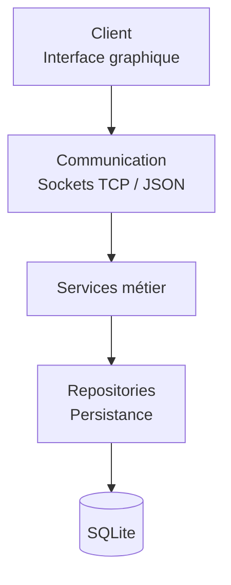
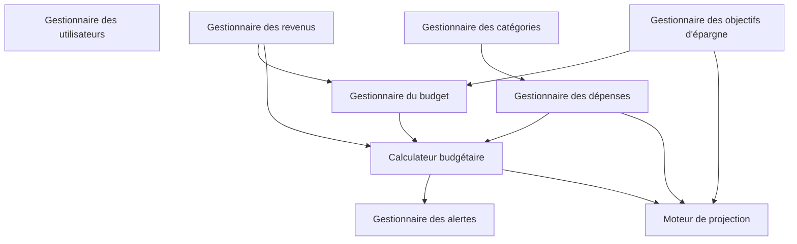
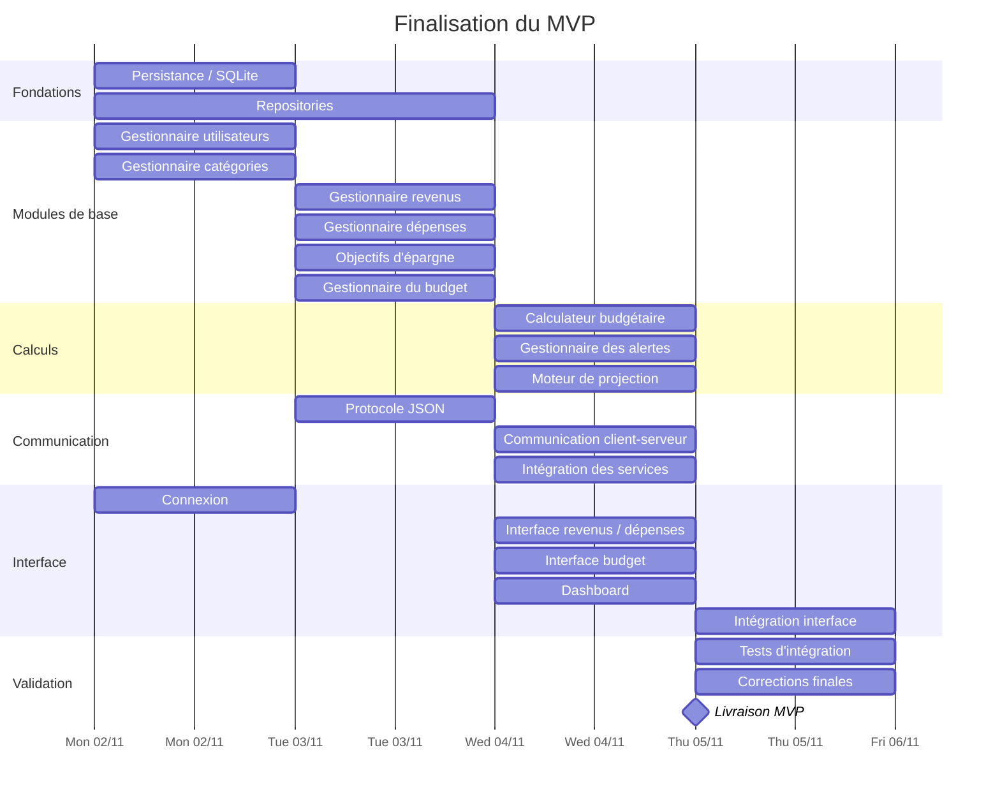
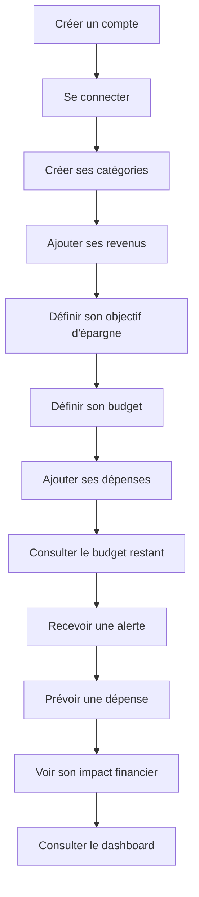
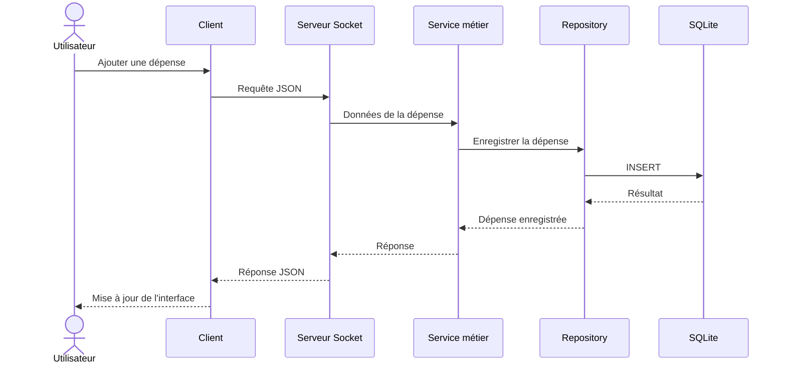
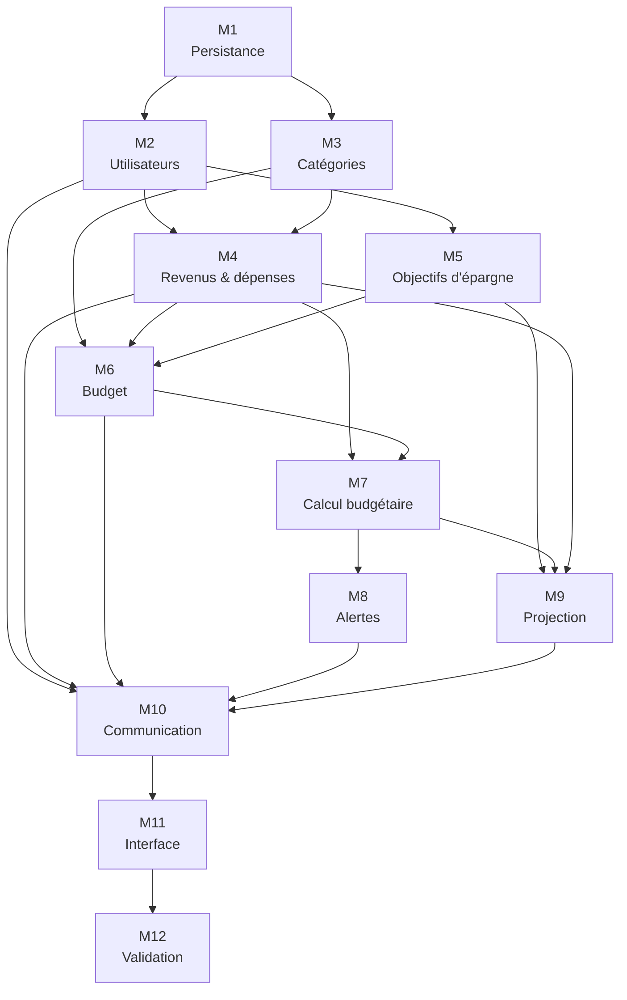
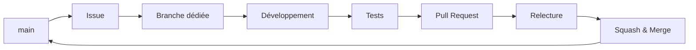

# Application de planification budgétaire

Application lourde de planification budgétaire destinée principalement aux étudiants.

## Objectif actuel

L'objectif prioritaire est de terminer un **MVP fonctionnel avant le jeudi 5 novembre 2026 à 22h00**.

Le MVP doit permettre à un utilisateur de :

- créer et gérer son compte ;
- gérer ses catégories et sous-catégories ;
- enregistrer ses revenus ;
- enregistrer ses dépenses ;
- définir son budget ;
- définir et suivre son objectif d'épargne ;
- connaître l'état actuel de son budget ;
- recevoir des alertes ;
- projeter l'impact d'une dépense prévue ;
- utiliser ces fonctionnalités depuis l'interface graphique.

Les fonctionnalités secondaires seront traitées uniquement si le MVP est terminé.

---

## Architecture du projet

L'application est organisée en trois grandes couches :



Le client ne communique pas directement avec la base de données.

Les services métier contiennent les responsabilités propres à l'application, tandis que les repositories assurent l'accès aux données.

## Démarrage local

Depuis la racine du dépôt :

```bash
python3 -m venv .venv
source .venv/bin/activate
python -m pip install -r requirements.txt
```

Démarrer le serveur dans un premier terminal :

```bash
python -m serveur.main
```

Puis démarrer l'application graphique dans un second terminal :

```bash
python client/main.py
```

Le serveur écoute par défaut sur `127.0.0.1:8765` et initialise la base
`persistance/data/budget.db`. Les fichiers SQLite de ce dossier sont ignorés
par Git afin de ne pas publier de données personnelles.

---

## Organisation des modules métier



Ces relations représentent les dépendances métier principales. Elles ne signifient pas nécessairement que les modules doivent être développés strictement les uns après les autres.

---

# Roadmap du MVP

## Gantt



**Deadline : jeudi 5 novembre 2026 à 22h00.**

---

# Milestones

## M0 — Fondations du projet

- [x] Architecture générale
- [x] Structure `client / serveur / persistance`
- [x] Responsabilités des modules
- [x] Organisation Git
- [x] Règles de contribution
- [x] Templates d'issues

## M1 — Persistance

- [ ] Finaliser le schéma SQLite
- [ ] Finaliser la connexion à la base
- [ ] Repository utilisateurs
- [ ] Repository catégories
- [ ] Repository revenus
- [ ] Repository dépenses
- [ ] Repository budgets
- [ ] Repository objectifs d'épargne
- [ ] Repository alertes

## M2 — Utilisateurs

- [ ] Création de compte
- [ ] Connexion
- [ ] Suppression de compte
- [ ] Séparation des données entre utilisateurs

## M3 — Catégories

- [ ] Création de catégories
- [ ] Création de sous-catégories
- [ ] Modification
- [ ] Suppression
- [ ] Récupération des catégories d'un utilisateur
- [ ] Tests

## M4 — Revenus et dépenses

### Revenus

- [ ] Ajout d'un revenu
- [ ] Revenu prévisionnel
- [ ] Revenu réellement reçu
- [ ] Modification
- [ ] Suppression

### Dépenses

- [ ] Ajout d'une dépense
- [ ] Dépense prévue
- [ ] Dépense réalisée
- [ ] Association catégorie / sous-catégorie
- [ ] Modification
- [ ] Suppression
- [ ] Historique

## M5 — Objectifs d'épargne

- [ ] Création d'un objectif
- [ ] Montant cible
- [ ] Date cible
- [ ] Montant d'épargne périodique
- [ ] Calcul du plan d'épargne
- [ ] Suivi de la progression
- [ ] Gestion d'un écart par rapport au plan

## M6 — Budget

- [ ] Définition du budget mensuel
- [ ] Catégories et sous-catégories
- [ ] Catégorie d'épargne
- [ ] Dépenses obligatoires
- [ ] Budget flexible
- [ ] Enveloppes hebdomadaires

## M7 — Calcul budgétaire

- [ ] Budget restant
- [ ] État des catégories
- [ ] Budget flexible disponible
- [ ] État des enveloppes hebdomadaires

## M8 — Alertes

- [ ] Seuil de 50 %
- [ ] Seuil de 80 %
- [ ] Dépassement du budget
- [ ] Passage sous le minimum défini par l'utilisateur
- [ ] Alertes liées aux projections

## M9 — Projection

- [ ] Projection de la situation future
- [ ] Simulation d'une dépense prévue
- [ ] Impact sur les catégories
- [ ] Impact sur le budget flexible
- [ ] Impact sur la capacité d'épargne
- [ ] Impact sur l'objectif d'épargne

## M10 — Communication

- [ ] Définir le protocole JSON
- [ ] Envoi des requêtes client
- [ ] Réception des requêtes serveur
- [ ] Traitement des requêtes
- [ ] Réponses serveur
- [ ] Connexion des services métier au serveur

## M11 — Interface MVP

- [ ] Interface de connexion
- [ ] Interface revenus / dépenses
- [ ] Interface budget
- [ ] Dashboard
- [ ] Connexion de l'interface aux services serveur

## M12 — Validation du MVP

- [ ] Tests d'intégration
- [ ] Parcours utilisateur complet
- [ ] Vérification de l'isolation des utilisateurs
- [ ] Vérification de la persistance
- [ ] Vérification de la communication client-serveur
- [ ] Correction des bugs bloquants
- [ ] Validation finale du MVP

## M13 — Fonctionnalités secondaires

À réaliser uniquement après la validation du MVP.

- [ ] Recherche et filtrage
- [ ] Gestion des investissements
- [ ] Documentation utilisateur
- [ ] Documentation technique
- [ ] Améliorations graphiques

---

# Parcours utilisateur minimum

Le parcours suivant doit fonctionner de bout en bout pour considérer le MVP comme fonctionnel :



---

# Flux technique d'une opération

Exemple : l'utilisateur ajoute une dépense.



---

# Dépendances principales



> Ce schéma représente les dépendances principales. Les issues peuvent néanmoins être développées en parallèle lorsque leur dépendance n'est pas bloquante.

---

# Organisation Git



Chaque fonctionnalité importante doit être associée à une issue.

Pour chaque issue :

1. définir le périmètre ;
2. identifier les dépendances ;
3. attribuer un responsable ;
4. créer une branche dédiée ;
5. développer ;
6. tester ;
7. créer une Pull Request ;
8. faire relire le travail ;
9. fusionner dans `main`.

---

# Priorités

## Priorité 1 — MVP

Tout ce qui est nécessaire au parcours utilisateur minimum :

- persistance ;
- utilisateurs ;
- catégories ;
- revenus ;
- dépenses ;
- objectifs d'épargne ;
- budget ;
- calcul budgétaire ;
- alertes ;
- projection ;
- communication ;
- interface ;
- tests.

## Priorité 2 — Après le MVP

- recherche et filtrage ;
- investissements ;
- documentation avancée ;
- améliorations graphiques.

**Si une fonctionnalité secondaire menace la livraison du MVP, elle doit être reportée.**

---

# Définition du MVP terminé

```mermaid
flowchart TD
    A["Serveur fonctionnel"]
    B["Base SQLite fonctionnelle"]
    C["Authentification fonctionnelle"]
    D["Catégories fonctionnelles"]
    E["Revenus et dépenses fonctionnels"]
    F["Objectif d'épargne fonctionnel"]
    G["Budget fonctionnel"]
    H["Calculs budgétaires fonctionnels"]
    I["Alertes fonctionnelles"]
    J["Projection fonctionnelle"]
    K["Communication client-serveur fonctionnelle"]
    L["Interface fonctionnelle"]
    M["Tests critiques passants"]
    N["MVP validé"]

    A --> N
    B --> N
    C --> N
    D --> N
    E --> N
    F --> N
    G --> N
    H --> N
    I --> N
    J --> N
    K --> N
    L --> N
    M --> N
```



Le MVP est terminé lorsque le parcours utilisateur minimum fonctionne de bout en bout et qu'aucun bug bloquant connu ne subsiste.

---

# Deadline

**Jeudi 5 novembre 2026 — 22h00**

La priorité absolue est la **livraison d'un MVP fonctionnel**.

Les fonctionnalités secondaires ne doivent pas compromettre cette échéance.
