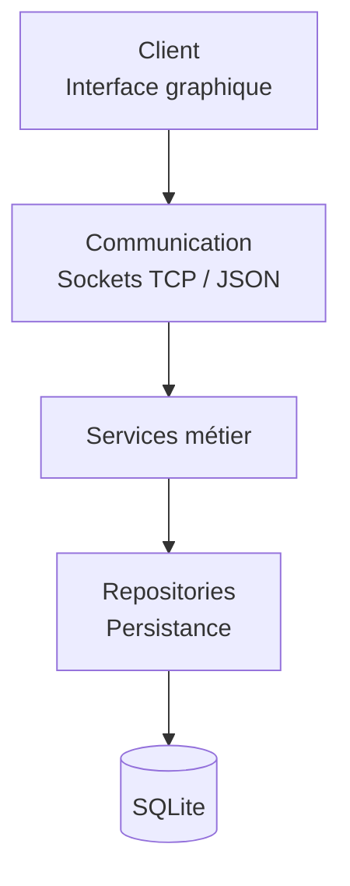
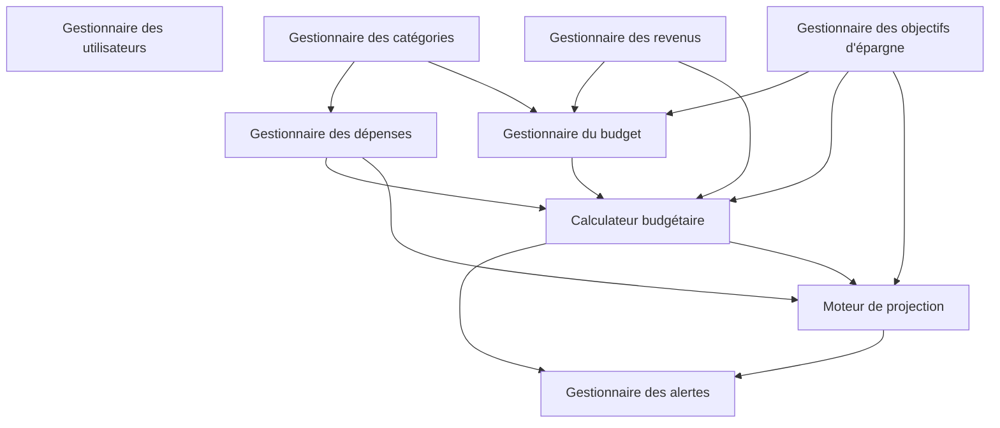
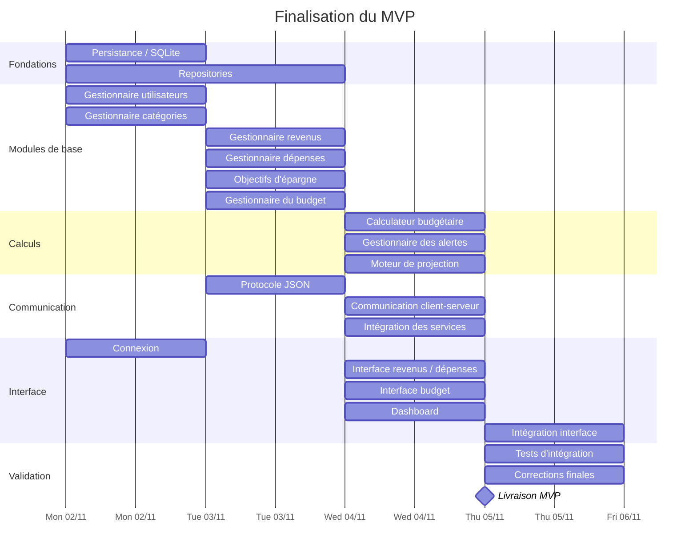
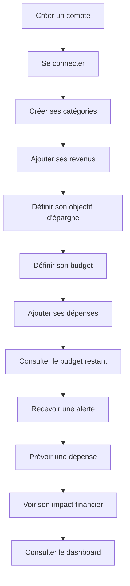
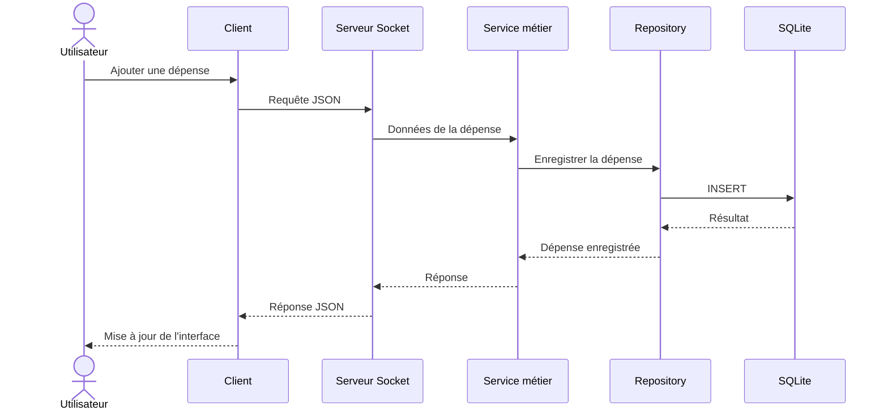
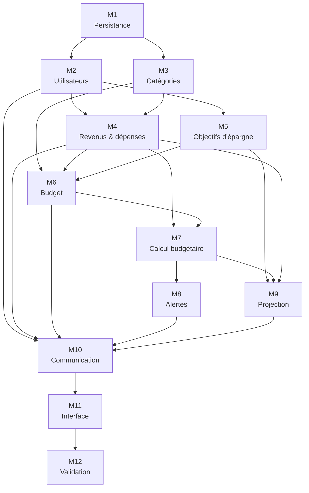
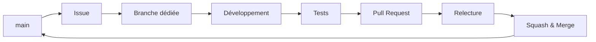

# Application de planification budgétaire

Application lourde de planification budgétaire destinée principalement aux étudiants.

## État actuel

Le MVP est fonctionnel. Son architecture métier a été réalignée sur les neuf
modules définis au début du projet : les calculs sont réalisés côté serveur,
le client se limite à la saisie et à la présentation, et les repositories se
limitent aux opérations SQLite.

Le MVP permet à un utilisateur de :

- créer et gérer son compte ;
- gérer ses catégories et sous-catégories ;
- enregistrer ses revenus ;
- enregistrer ses dépenses ;
- définir son budget ;
- définir et suivre son objectif d'épargne ;
- connaître l'état actuel de son budget ;
- recevoir des alertes ;
- projeter l'impact d'une dépense prévue ;
- utiliser ces fonctionnalités depuis l'interface graphique.

Les fonctionnalités secondaires seront traitées uniquement si le MVP est terminé.

---

## Architecture du projet

L'application est organisée en trois grandes couches :



Le client ne communique pas directement avec la base de données.

Les services métier contiennent les responsabilités propres à l'application, tandis que les repositories assurent l'accès aux données.

## Installation et lancement

L'application fonctionne sous Linux et repose sur une architecture client-serveur :
- **Serveur :** Python, exécuté avec Docker.
- **Client :** interface graphique distribuée au format AppImage.
- **Base de données :** SQLite (`budget.db`).

### 1. Installation du serveur

#### Prérequis

Le serveur nécessite **Docker Engine** et **Docker Compose v2**.

Vérifier leur installation :

```bash
docker --version
docker compose version
```

Si Docker Compose v2 est absent, sur Ubuntu 24.04 ou Linux Mint compatible :

```bash
sudo apt update
sudo apt install docker-compose-v2
```

#### Récupérer le projet

```bash
git clone https://github.com/TheMuliama/plannification_budgetaire.git
cd plannification_budgetaire
```

#### Démarrer le serveur

```bash
docker compose up --build -d
```

Vérifier son fonctionnement :

```bash
docker compose ps
```

Le serveur est accessible localement sur `127.0.0.1:8766`.

### 2. Installation du client Linux

Le client est disponible au format **AppImage**. Aucune installation de Python ou des dépendances Python n'est nécessaire.

1. Accéder aux [GitHub Releases](https://github.com/TheMuliama/plannification_budgetaire/releases).
2. Télécharger `Budget-x86_64.AppImage`.
3. Ouvrir un terminal dans le dossier contenant le fichier.

Autoriser son exécution :

```bash
chmod +x Budget-x86_64.AppImage
```

Lancer l'application :

```bash
./Budget-x86_64.AppImage
```

**Important :** le serveur Docker doit être démarré avant l'utilisation du client. Cette configuration nécessite que les deux programmes fonctionnent sur le même ordinateur.

### 3. Arrêter le serveur

Depuis le dossier du projet :

```bash
docker compose down
```

Les données sont conservées dans `persistance/data/budget.db`.

### 4. Documentation

Pour davantage d'informations, consultez la notice d'installation et d'utilisation fournie avec le projet.

## Compte de démonstration

Le compte destiné à la présentation et aux tests du professeur est :

```text
Identifiant : richard.latchoumane@univ-reunion.fr
Mot de passe : Richard-2026!
```

Il contient un scénario d'utilisation normal de juin à novembre 2026 :
48 budgets mensuels, 14 revenus, 59 dépenses réalisées ou prévues, deux
objectifs d'épargne et dix versements. Les données couvrent également les
alertes à 80 %, l'évolution sur six mois et les opérations récurrentes.

Le scénario peut être recréé sans modifier les autres comptes avec :

```bash
python -m scripts.peupler_compte_richard
```

---

## Organisation des modules métier



Ces relations représentent les dépendances métier principales. Elles ne
signifient pas nécessairement que les modules doivent être développés
strictement les uns après les autres.

| Module | Rôle effectif | Dépendances métier |
| --- | --- | --- |
| `GestionnaireUtilisateurs` | Comptes, authentification et mots de passe | Aucune |
| `GestionnaireCategories` | Catégories, sous-catégories et validation des classements | Aucune |
| `GestionnaireRevenus` | Revenus prévus/reçus et totaux par période | Aucune |
| `GestionnaireObjectifsEpargne` | Objectifs, versements, plans, écarts et scénarios | Aucune |
| `GestionnaireBudget` | Construction du budget mensuel, allocations et épargne prévue | Revenus, objectifs, catégories |
| `GestionnaireDepenses` | Dépenses prévues/réalisées et validation de leurs rattachements | Catégories, budget |
| `CalculateurBudget` | Solde, consommation, budget flexible, enveloppes et capacité d'épargne | Budget, revenus, dépenses, objectifs |
| `MoteurProjection` | Impact futur des dépenses prévues sur le budget et l'épargne | Calculateur, dépenses, objectifs |
| `GestionnaireAlertes` | Alertes de consommation à partir de 80 % et risques projetés | Calculateur, projection |

`GestionnaireSessions` reste un composant de sécurité et non un module métier.
Les anciens services parallèles de solde et d'analyse d'épargne ont été
absorbés par `CalculateurBudget`.

Le serveur expose notamment les états calculés avec `budgets.etat`,
`dashboard.obtenir`, `alertes.lister` et `projection.simuler`. Les séries de
revenus et de dépenses récurrentes sont développées côté serveur afin qu'un
client ne puisse pas contourner les validations financières.

La suite automatisée couvre les services, la persistance, le protocole et les
principaux parcours intégrés. Elle s'exécute avec :

```bash
python -m pytest -q
```

---

# Roadmap historique du MVP

Cette roadmap décrit la planification initiale. L'état effectif et les
dépendances actuellement implémentées sont décrits dans la section précédente.

## Gantt




---

# Parcours utilisateur minimum

Le parcours suivant doit fonctionner de bout en bout pour considérer le MVP comme fonctionnel :



---

# Flux technique d'une opération

Exemple : l'utilisateur ajoute une dépense.



---

# Dépendances principales



> Ce schéma représente les dépendances principales. Les issues peuvent néanmoins être développées en parallèle lorsque leur dépendance n'est pas bloquante.

---

# Organisation Git



Chaque fonctionnalité importante doit être associée à une issue.

Pour chaque issue :

1. définir le périmètre ;
2. identifier les dépendances ;
3. attribuer un responsable ;
4. créer une branche dédiée ;
5. développer ;
6. tester ;
7. créer une Pull Request ;
8. faire relire le travail ;
9. fusionner dans `main`.

Les fonctionnalités secondaires ne doivent pas compromettre cette échéance.
